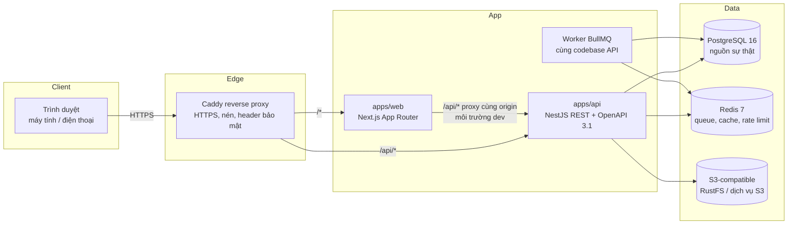

# Kiến trúc hệ thống — Business CRM

Phiên bản đặc tả: 1.2 · Cập nhật: Sprint 0 (2026-10-19)

## 1. Bối cảnh và mục tiêu

Business CRM thay thế hoàn toàn phần mềm hiện tại của một doanh nghiệp bán lẻ B2C Việt Nam:
một cửa hàng, một kho chính, 6–15 nhân viên (Giám đốc, Trưởng nhóm, Sales, CSKH, Kho, Kế toán),
bán hàng có serial và không serial, hàng mới / đã qua sử dụng / bảo hành. Hệ thống phải mở rộng
được sang nhiều cửa hàng mà không phải thiết kế lại dữ liệu.

Thuộc tính chất lượng theo thứ tự ưu tiên (đặc tả §1):

1. **Đúng đắn và toàn vẹn dữ liệu** cho tiền, kho, quyền.
2. **Bảo mật**: quyền kiểm tra ở backend cho từng API, chống IDOR, audit đầy đủ.
3. **Khả năng bảo trì**: modular monolith, quy tắc nghiệp vụ tập trung, kiểm thử tự động.
4. Hiệu năng ở quy mô nhỏ (≤ 15 người dùng đồng thời, hàng chục nghìn đơn/năm): không phải yếu tố
   quyết định kiến trúc; PostgreSQL đơn lẻ là đủ.

## 2. Tổng quan



- **Một API duy nhất** (modular monolith). Không microservices ở giai đoạn đầu (đặc tả §3).
- **PostgreSQL là nguồn sự thật duy nhất** cho tiền, kho, quyền. Redis chỉ giữ dữ liệu có thể mất
  (cache, hàng đợi có outbox trong PostgreSQL bảo đảm).
- **Web không truy cập database**; mọi dữ liệu đi qua API đã kiểm tra quyền.

## 3. Cấu trúc monorepo

```
business-crm/
├── apps/
│   ├── api/            NestJS: src/modules/<module>, src/infrastructure, prisma/ (schema + migrations)
│   └── web/            Next.js: src/app (routes), src/components, src/config, src/lib
├── packages/
│   ├── shared/         Quy tắc nghiệp vụ thuần TypeScript dùng chung web + api:
│   │                   vai trò, danh mục quyền, ma trận mặc định, state machine, tiền VND, múi giờ, schema Zod
│   ├── ui/             Thành phần shadcn/ui dùng chung
│   └── config/         tsconfig + ESLint dùng chung
├── tests/e2e/          Playwright chạy trên stack thật
├── infrastructure/     Dockerfile, Caddyfile, script backup/restore, init PostgreSQL
└── docs/               Tài liệu (kiến trúc, nghiệp vụ, database, API, bảo mật, kiểm thử, báo cáo)
```

Công cụ: pnpm workspaces + Turborepo (cache build/test theo package), TypeScript strict.

## 4. Phân tầng trong API

Mỗi module nghiệp vụ (`src/modules/<tên>`) gồm:

| Tầng                                               | Trách nhiệm                                                                     | Không được                                 |
| -------------------------------------------------- | ------------------------------------------------------------------------------- | ------------------------------------------ |
| Controller                                         | Định tuyến, parse/validate input bằng Zod, khai báo quyền yêu cầu, OpenAPI      | Chứa logic nghiệp vụ, truy cập Prisma      |
| Service (application)                              | Transaction, kiểm tra state machine + guard, gọi repository, ghi audit + outbox | Tin dữ liệu từ client về giá/giá vốn/quyền |
| Domain (thuần, trong `@crm/shared` hoặc `domain/`) | Công thức tiền, chuyển trạng thái, quy tắc giá sàn                              | Phụ thuộc framework/DB                     |
| Repository / Prisma                                | Truy vấn có lọc phạm vi dữ liệu (OWN/TEAM/STORE/ORG)                            | Bỏ qua bộ lọc phạm vi                      |

Module dự kiến (khớp đặc tả §4): `auth`, `access` (RBAC), `organization`, `customer`, `lead`,
`task`, `employee`, `product`, `pricing`, `inventory`, `order`, `payment`, `refund`, `commission`,
`reporting`, `audit`, `notification`. Module chỉ gọi nhau qua service đã export, không truy vấn bảng
của module khác trực tiếp (trừ báo cáo chỉ đọc).

## 5. Các cơ chế toàn vẹn dữ liệu (áp dụng từ Sprint 1)

| Vấn đề                    | Cơ chế                                                                                                                | Ghi chú                                                             |
| ------------------------- | --------------------------------------------------------------------------------------------------------------------- | ------------------------------------------------------------------- |
| Tiền                      | `BIGINT` đồng VND; tỷ lệ là `INT` basis point; làm tròn tường minh (`@crm/shared/money`)                              | Không float ở bất kỳ tầng nào; JSON truyền tiền dạng chuỗi          |
| Sửa đồng thời             | Cột `version` + `If-Match`; `UPDATE … WHERE id=? AND version=?` → 0 dòng = `409 VERSION_CONFLICT`                     | Áp dụng cho đơn, chứng từ, khách hàng, cấu hình                     |
| Tạo trùng (double submit) | Bảng `idempotency_keys` + header `Idempotency-Key` cho mọi thao tác tạo tiền/kho/đơn                                  | Cùng key + khác body → `422`; cùng key đang xử lý → `409`           |
| Xuất kho/serial đồng thời | Transaction `SERIALIZABLE` hoặc `SELECT … FOR UPDATE` trên dòng tồn/serial; CHECK `qty_available >= 0`; unique serial | Thứ tự khóa cố định (theo `product_id`, `serial`) để tránh deadlock |
| Hoàn tiền/thanh toán vượt | Khóa dòng đơn khi tính số còn có thể hoàn; CHECK tổng ở DB                                                            | Kiểm thử bắt buộc: hoàn trùng, thanh toán trùng                     |
| Chứng từ POSTED bất biến  | State machine + trigger chặn UPDATE dòng POSTED; sửa sai bằng chứng từ đảo                                            | Chỉ Giám đốc (`inventory.reverse`)                                  |
| Phê duyệt giá sàn         | Gắn `order_id + order_version + hash điều kiện giá`; mọi thay đổi đơn → `INVALIDATE`                                  | Xác nhận đơn kiểm tra lại trong cùng transaction                    |
| Kỳ hoa hồng đã chốt       | Trigger chặn sửa dòng thuộc kỳ `CLOSED`; điều chỉnh đi vào kỳ mở                                                      |                                                                     |
| Audit                     | `audit_logs` append-only (trigger chặn UPDATE/DELETE/TRUNCATE), ghi trong cùng transaction nghiệp vụ                  | Đã có từ Sprint 0                                                   |
| Sự kiện bất đồng bộ       | Transactional outbox (`outbox_events`) → worker BullMQ                                                                | Không mất thông báo khi Redis gián đoạn                             |

## 6. Phân quyền

- RBAC + phạm vi dữ liệu. Quyền dạng `module.action` với phạm vi `OWN | TEAM | STORE | ORG`
  (xem [PERMISSION_MATRIX.md](../security/PERMISSION_MATRIX.md)).
- Ma trận lưu trong DB (`roles`, `permissions`, `role_permissions`, `user_roles`); mã nguồn chỉ giữ
  ma trận **mặc định** để seed. Không hardcode quyền trong logic.
- Quyền **chỉ-giám-đốc** (quy tắc đã khóa): duyệt bán dưới giá sàn, điều chỉnh tồn, duyệt sửa chứng
  từ đã ghi sổ, giao dịch đảo, duyệt và thực hiện hoàn tiền. Chặn ở ứng dụng + trigger DB.
- Mỗi endpoint khai báo quyền bằng decorator (Sprint 1); guard toàn cục **từ chối mặc định** khi
  endpoint không khai báo quyền (trừ endpoint công khai được đánh dấu tường minh như health).
- Chống IDOR: repository luôn nhận `AccessContext` (user, roles, scope) và thêm điều kiện phạm vi vào
  câu truy vấn; truy cập bản ghi ngoài phạm vi trả `404` (không tiết lộ sự tồn tại).

## 7. Xác thực (thiết kế cho Sprint 1)

- Phiên phía server: cookie `HttpOnly; Secure; SameSite=Lax` chứa token ngẫu nhiên 256-bit; DB chỉ
  lưu SHA-256 (`sessions.token_hash`). Thu hồi phiên = đặt `revoked_at`.
- CSRF: double-submit token (`x-csrf-token`) cho mọi request thay đổi dữ liệu + kiểm tra `Origin`.
- Mật khẩu: Argon2id; khóa tài khoản sau N lần sai (cấu hình); rate limit theo IP + tài khoản.
- MFA TOTP bắt buộc cho Super Admin, Giám đốc, Kế toán (đề xuất, xem OPEN_DECISIONS D-07);
  bí mật TOTP mã hóa AES-256-GCM bằng khóa từ biến môi trường.
- Không có tài khoản admin mặc định: Super Admin đầu tiên tạo bằng lệnh CLI một lần, mật khẩu do
  người vận hành nhập.

## 8. Frontend

- Next.js App Router, TypeScript strict, Tailwind CSS v4, shadcn/ui, TanStack Query, React Hook Form + Zod.
- Trình duyệt gọi `/api/*` **cùng origin**; route handler `app/api/[...path]` chuyển tiếp tới API
  (đọc `API_INTERNAL_URL` lúc chạy). Production: Caddy định tuyến `/api/*` thẳng tới API.
- Schema Zod và kiểu dữ liệu dùng chung từ `@crm/shared` → form validate giống backend.
- Mục menu chưa triển khai hiển thị vô hiệu kèm sprint dự kiến (không có nút trang trí).
- Giao diện nhân viên đơn giản hơn giám đốc: menu và dashboard lọc theo quyền (Sprint 1+).

## 9. Hạ tầng

| Thành phần    | Dev (docker compose)                                     | Production (đề xuất)                                    |
| ------------- | -------------------------------------------------------- | ------------------------------------------------------- |
| PostgreSQL 16 | container `postgres`                                     | PostgreSQL quản lý hoặc VM riêng, backup tự động + PITR |
| Redis 7       | container `redis` (AOF, mật khẩu)                        | Redis có mật khẩu, không public                         |
| S3            | RustFS (MinIO ngừng phát hành image cộng đồng)           | Dịch vụ S3-compatible (bucket private, URL ký hạn ngắn) |
| Reverse proxy | Caddy (`--profile app`)                                  | Caddy với domain thật → HTTPS tự động                   |
| Email         | Mailpit (bắt mail dev)                                   | SMTP doanh nghiệp                                       |
| Migration     | service `migrate` chạy `prisma migrate deploy` trước API | Job một lần trong pipeline triển khai                   |

Secrets chỉ qua biến môi trường; API từ chối khởi động production nếu cấu hình còn mật khẩu mẫu.

## 10. Mở rộng nhiều cửa hàng

Đã chuẩn bị từ schema nền tảng: `organizations → stores → warehouses`, `teams` thuộc store,
`user_roles.store_id` (NULL = mọi cửa hàng), phạm vi quyền `STORE`. Mọi bảng nghiệp vụ sau này
mang `store_id` / `warehouse_id`.

## 11. Quyết định kiến trúc

Xem [DECISIONS.md](./DECISIONS.md) (ADR) và các quyết định nghiệp vụ còn mở tại
[OPEN_DECISIONS.md](../business-rules/OPEN_DECISIONS.md).
