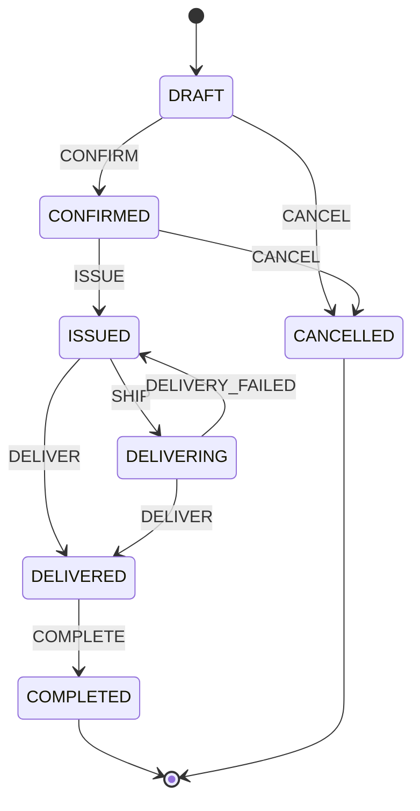
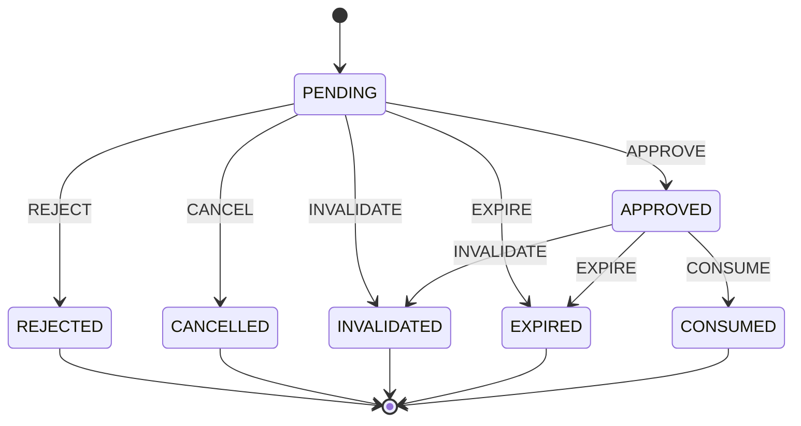
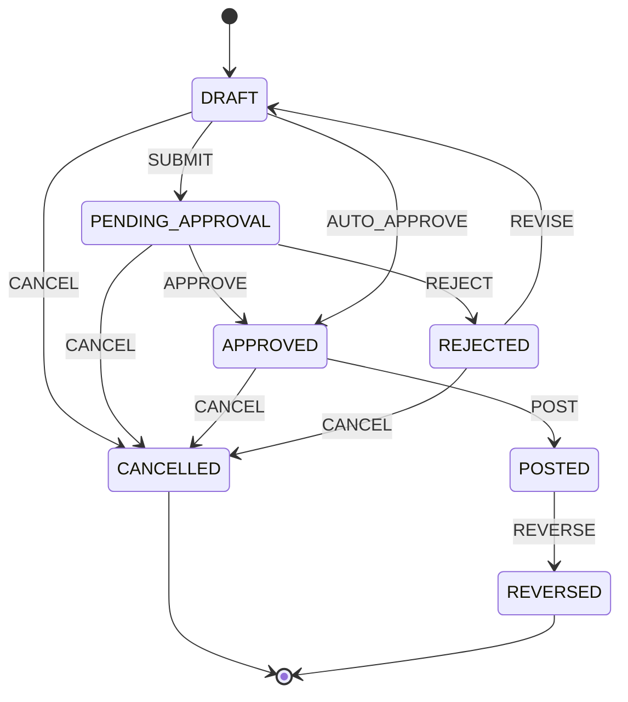
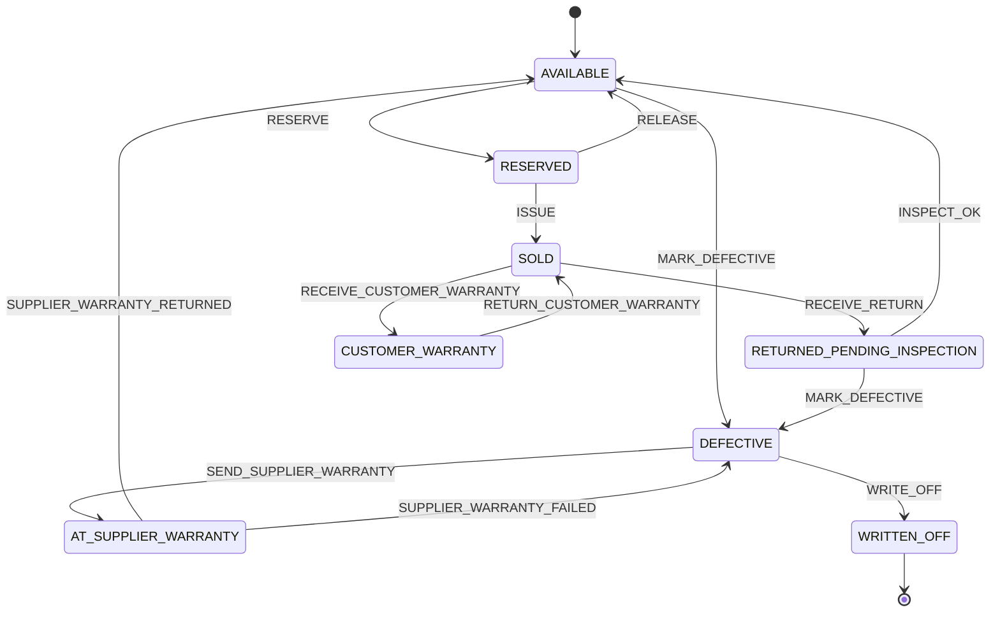
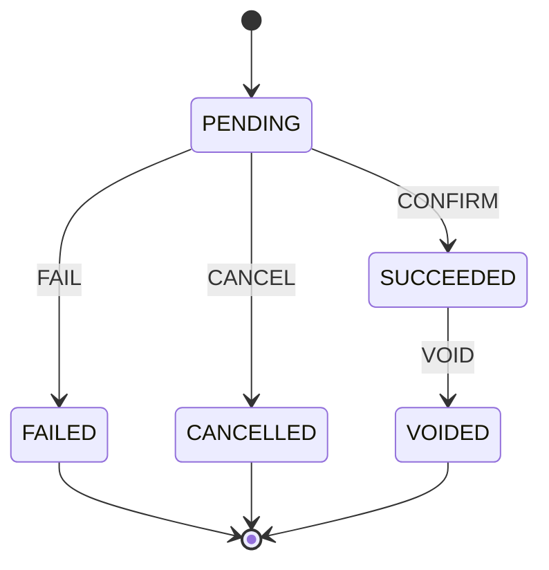
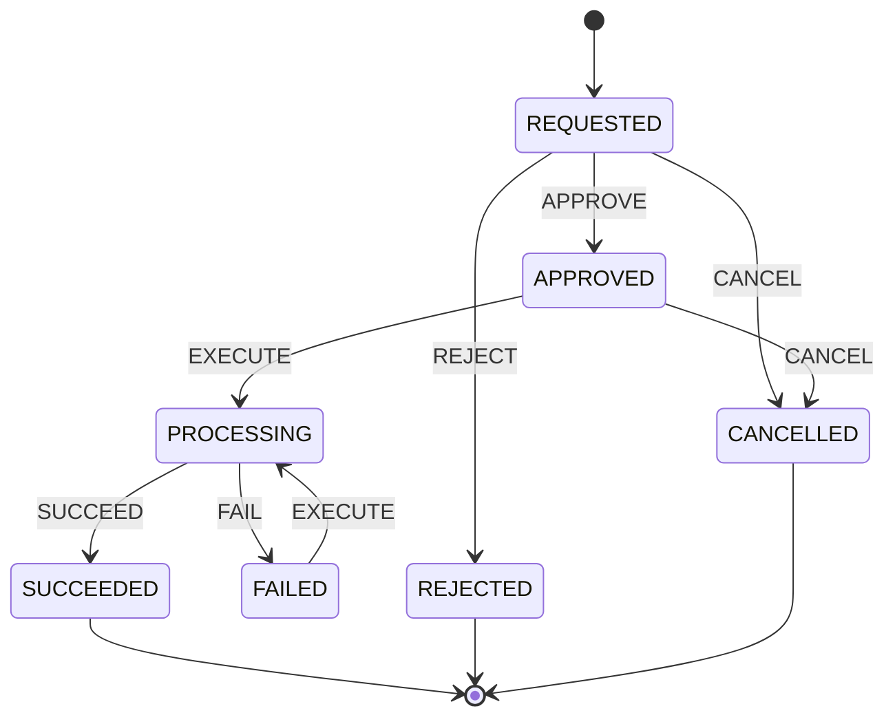
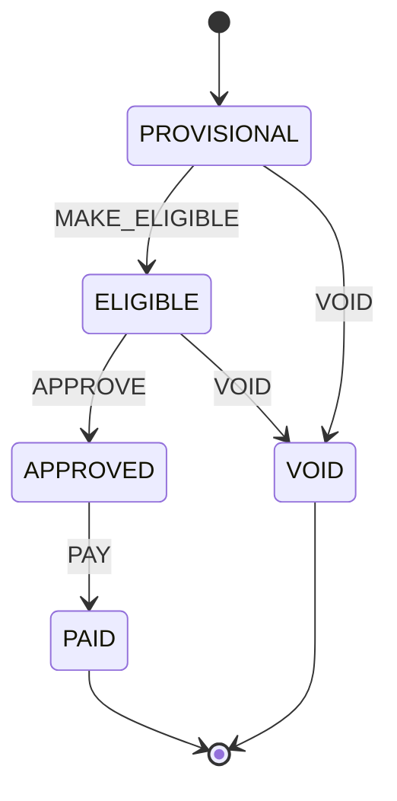
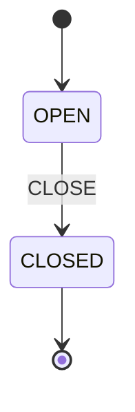
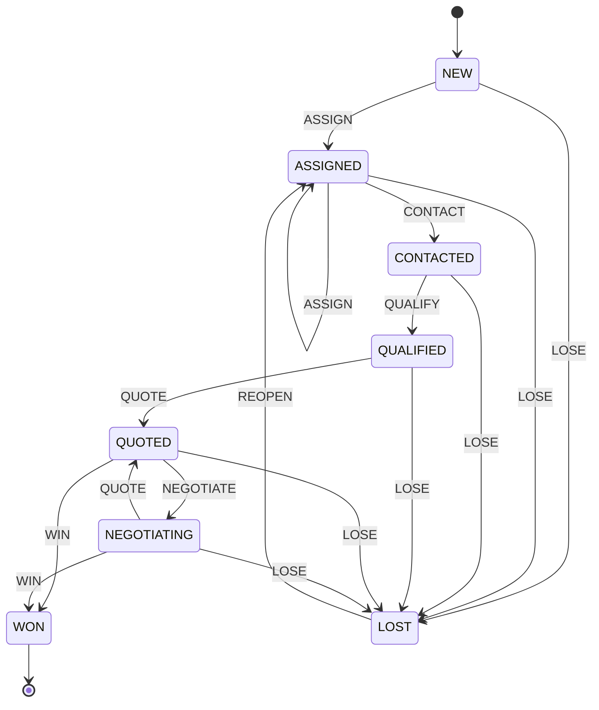
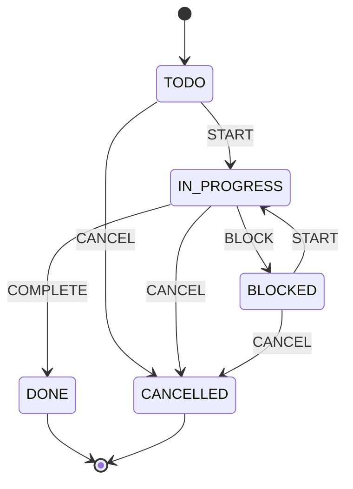

<!-- TỆP SINH TỰ ĐỘNG từ packages/shared — không sửa tay. Chạy `pnpm docs:generate`. -->

# State machine (sinh từ mã nguồn)

Giải thích thiết kế: [STATE_MACHINES.md](./STATE_MACHINES.md). Định nghĩa: `packages/shared/src/state-machines/machines.ts`.

## Đơn hàng (`order`)

| Trạng thái             | Ý nghĩa                  |
| ---------------------- | ------------------------ |
| `DRAFT` (khởi đầu)     | Nháp                     |
| `CONFIRMED`            | Đã xác nhận (đã giữ tồn) |
| `ISSUED`               | Đã xuất kho              |
| `DELIVERING`           | Đang giao                |
| `DELIVERED`            | Đã giao                  |
| `COMPLETED` (kết thúc) | Hoàn tất                 |
| `CANCELLED` (kết thúc) | Đã hủy                   |

| Sự kiện           | Từ                     | Đến          | Quyền           | Điều kiện bắt buộc                                                                                                                             | Mô tả                                                                   |
| ----------------- | ---------------------- | ------------ | --------------- | ---------------------------------------------------------------------------------------------------------------------------------------------- | ----------------------------------------------------------------------- |
| `CONFIRM`         | `DRAFT`                | `CONFIRMED`  | `order.confirm` | `expectedVersionMatches` `allLinesAtOrAboveFloor OR priceExceptionApprovedForCurrentVersion` `stockReservable` `idempotencyKeyUnused` | Khóa giá, snapshot giá/giá vốn/thuế/chính sách hoa hồng, giữ tồn.       |
| `ISSUE`           | `CONFIRMED`            | `ISSUED`     | `order.fulfill` | `issueDocumentPosted` `serialsNotIssuedElsewhere`                                                                                           | Xuất kho theo phiếu xuất đã ghi sổ.                                     |
| `SHIP`            | `ISSUED`               | `DELIVERING` | `order.fulfill` |                                                                                                                                                | Bàn giao cho đơn vị/nhân viên giao hàng.                                |
| `DELIVERY_FAILED` | `DELIVERING`           | `ISSUED`     | `order.fulfill` |                                                                                                                                                | Giao không thành công, hàng quay về cửa hàng.                           |
| `DELIVER`         | `ISSUED`, `DELIVERING` | `DELIVERED`  | `order.fulfill` |                                                                                                                                                | Khách đã nhận hàng (tại quầy hoặc giao tận nơi).                        |
| `COMPLETE`        | `DELIVERED`            | `COMPLETED`  | `order.fulfill` | `fullyPaid OR debtApproved`                                                                                                                    | Hoàn tất đơn.                                                           |
| `CANCEL`          | `DRAFT`, `CONFIRMED`   | `CANCELLED`  | `order.cancel`  | `releaseReservation` `noNetPaymentOrRefundRequested`                                                                                        | Hủy đơn; nhả tồn đã giữ. Đơn đã thu tiền phải đi qua yêu cầu hoàn tiền. |

## Ngoại lệ giá sàn (`priceException`)

| Trạng thái               | Ý nghĩa                      |
| ------------------------ | ---------------------------- |
| `PENDING` (khởi đầu)     | Chờ giám đốc duyệt           |
| `APPROVED`               | Đã duyệt                     |
| `REJECTED` (kết thúc)    | Từ chối                      |
| `CANCELLED` (kết thúc)   | Người yêu cầu hủy            |
| `INVALIDATED` (kết thúc) | Mất hiệu lực do đơn thay đổi |
| `EXPIRED` (kết thúc)     | Hết hạn                      |
| `CONSUMED` (kết thúc)    | Đã dùng để xác nhận đơn      |

| Sự kiện      | Từ                    | Đến           | Quyền                     | Điều kiện bắt buộc                                                  | Mô tả                                                                       |
| ------------ | --------------------- | ------------- | ------------------------- | ------------------------------------------------------------------- | --------------------------------------------------------------------------- |
| `APPROVE`    | `PENDING`             | `APPROVED`    | `price_exception.approve` | `orderVersionUnchanged` `notExpired` `approverIsNotRequester` | Giám đốc duyệt sau khi xem giá sàn, giá đề xuất, lợi nhuận, lý do.          |
| `REJECT`     | `PENDING`             | `REJECTED`    | `price_exception.approve` |                                                                     | Giám đốc từ chối (bắt buộc lý do).                                          |
| `CANCEL`     | `PENDING`             | `CANCELLED`   | `price_exception.request` |                                                                     | Người yêu cầu rút lại.                                                      |
| `INVALIDATE` | `PENDING`, `APPROVED` | `INVALIDATED` | _hệ thống_                |                                                                     | Hệ thống: đơn đổi phiên bản / giá / số lượng / giá sàn / giá vốn liên quan. |
| `EXPIRE`     | `PENDING`, `APPROVED` | `EXPIRED`     | _hệ thống_                |                                                                     | Hệ thống: quá thời hạn hiệu lực.                                            |
| `CONSUME`    | `APPROVED`            | `CONSUMED`    | _hệ thống_                | `sameOrderVersion` `samePriceConditions`                         | Hệ thống: dùng khi xác nhận đơn, trong cùng transaction.                    |

## Chứng từ kho (`inventoryDocument`)

| Trạng thái             | Ý nghĩa    |
| ---------------------- | ---------- |
| `DRAFT` (khởi đầu)     | Nháp       |
| `PENDING_APPROVAL`     | Chờ duyệt  |
| `APPROVED`             | Đã duyệt   |
| `POSTED`               | Đã ghi sổ  |
| `REJECTED`             | Bị từ chối |
| `CANCELLED` (kết thúc) | Đã hủy     |
| `REVERSED` (kết thúc)  | Đã bị đảo  |

| Sự kiện        | Từ                                                  | Đến                | Quyền                        | Điều kiện bắt buộc                                                             | Mô tả                                                                 |
| -------------- | --------------------------------------------------- | ------------------ | ---------------------------- | ------------------------------------------------------------------------------ | --------------------------------------------------------------------- |
| `SUBMIT`       | `DRAFT`                                             | `PENDING_APPROVAL` | `inventory.document.create`  |                                                                                | Gửi duyệt.                                                            |
| `APPROVE`      | `PENDING_APPROVAL`                                  | `APPROVED`         | `inventory.document.approve` | `adjustmentTypeRequiresDirector`                                               | Duyệt chứng từ. Chứng từ điều chỉnh tồn chỉ Giám đốc duyệt.           |
| `AUTO_APPROVE` | `DRAFT`                                             | `APPROVED`         | _hệ thống_                   | `sourceDocumentApproved`                                                       | Hệ thống: phiếu xuất sinh từ đơn đã xác nhận (chứng từ nguồn hợp lệ). |
| `REJECT`       | `PENDING_APPROVAL`                                  | `REJECTED`         | `inventory.document.approve` |                                                                                | Từ chối, bắt buộc lý do.                                              |
| `REVISE`       | `REJECTED`                                          | `DRAFT`            | `inventory.document.create`  |                                                                                | Sửa lại chứng từ bị từ chối.                                          |
| `POST`         | `APPROVED`                                          | `POSTED`           | `inventory.document.post`    | `availableQtyNeverNegative` `serialsInExpectedState` `rowLockedBalances` | Ghi sổ: tạo stock_movements, cập nhật số dư trong một transaction.    |
| `CANCEL`       | `DRAFT`, `PENDING_APPROVAL`, `APPROVED`, `REJECTED` | `CANCELLED`        | `inventory.document.create`  |                                                                                | Hủy chứng từ chưa ghi sổ.                                             |
| `REVERSE`      | `POSTED`                                            | `REVERSED`         | `inventory.reverse`          | `createsMirrorReversalDocument` `reversalDoesNotMakeStockNegative`          | Chỉ Giám đốc: tạo chứng từ đảo đã ghi sổ; chứng từ gốc không bị sửa.  |

## Hàng có serial (`stockUnit`)

| Trạng thái                    | Ý nghĩa                          |
| ----------------------------- | -------------------------------- |
| `AVAILABLE` (khởi đầu)        | Sẵn bán                          |
| `RESERVED`                    | Đang giữ cho đơn                 |
| `SOLD`                        | Đã bán / đã xuất                 |
| `RETURNED_PENDING_INSPECTION` | Khách trả, chờ kiểm tra          |
| `DEFECTIVE`                   | Hàng lỗi                         |
| `AT_SUPPLIER_WARRANTY`        | Gửi bảo hành nhà cung cấp        |
| `CUSTOMER_WARRANTY`           | Hàng bảo hành của khách đang giữ |
| `WRITTEN_OFF` (kết thúc)      | Đã hủy / xóa sổ                  |

| Sự kiện                      | Từ                                         | Đến                           | Quyền                     | Điều kiện bắt buộc     | Mô tả                                                                            |
| ---------------------------- | ------------------------------------------ | ----------------------------- | ------------------------- | ---------------------- | -------------------------------------------------------------------------------- |
| `RESERVE`                    | `AVAILABLE`                                | `RESERVED`                    | _hệ thống_                |                        | Giữ cho đơn đã xác nhận.                                                         |
| `RELEASE`                    | `RESERVED`                                 | `AVAILABLE`                   | _hệ thống_                |                        | Nhả giữ khi hủy đơn.                                                             |
| `ISSUE`                      | `RESERVED`                                 | `SOLD`                        | _hệ thống_                | `reservedForSameOrder` | Xuất theo phiếu xuất đã ghi sổ. Serial chỉ xuất một lần.                         |
| `RECEIVE_RETURN`             | `SOLD`                                     | `RETURNED_PENDING_INSPECTION` | _hệ thống_                |                        | Nhận lại hàng khách trả theo phiếu trả đã duyệt.                                 |
| `INSPECT_OK`                 | `RETURNED_PENDING_INSPECTION`              | `AVAILABLE`                   | `inventory.status.change` |                        | Kiểm tra đạt, nhập lại tồn bán (có thể đổi tình trạng sang hàng đã qua sử dụng). |
| `MARK_DEFECTIVE`             | `AVAILABLE`, `RETURNED_PENDING_INSPECTION` | `DEFECTIVE`                   | `inventory.status.change` |                        | Đánh dấu hàng lỗi.                                                               |
| `SEND_SUPPLIER_WARRANTY`     | `DEFECTIVE`                                | `AT_SUPPLIER_WARRANTY`        | `inventory.status.change` |                        | Gửi bảo hành nhà cung cấp.                                                       |
| `SUPPLIER_WARRANTY_RETURNED` | `AT_SUPPLIER_WARRANTY`                     | `AVAILABLE`                   | `inventory.status.change` |                        | Nhận lại từ bảo hành, đạt.                                                       |
| `SUPPLIER_WARRANTY_FAILED`   | `AT_SUPPLIER_WARRANTY`                     | `DEFECTIVE`                   | `inventory.status.change` |                        | Bảo hành không đạt.                                                              |
| `RECEIVE_CUSTOMER_WARRANTY`  | `SOLD`                                     | `CUSTOMER_WARRANTY`           | `inventory.status.change` |                        | Nhận máy khách gửi bảo hành.                                                     |
| `RETURN_CUSTOMER_WARRANTY`   | `CUSTOMER_WARRANTY`                        | `SOLD`                        | `inventory.status.change` |                        | Trả máy bảo hành cho khách.                                                      |
| `WRITE_OFF`                  | `DEFECTIVE`                                | `WRITTEN_OFF`                 | `inventory.adjust`        |                        | Chỉ Giám đốc: xóa sổ hàng hỏng.                                                  |

## Thanh toán (`payment`)

| Trạng thái             | Ý nghĩa                |
| ---------------------- | ---------------------- |
| `PENDING` (khởi đầu)   | Chờ xác nhận tiền về   |
| `SUCCEEDED`            | Thành công             |
| `FAILED` (kết thúc)    | Thất bại               |
| `CANCELLED` (kết thúc) | Đã hủy                 |
| `VOIDED` (kết thúc)    | Hủy ghi nhận (sai sót) |

| Sự kiện   | Từ          | Đến         | Quyền            | Điều kiện bắt buộc                                     | Mô tả                                                    |
| --------- | ----------- | ----------- | ---------------- | ------------------------------------------------------ | -------------------------------------------------------- |
| `CONFIRM` | `PENDING`   | `SUCCEEDED` | `payment.record` | `idempotencyKeyUnused` `amountNotExceedOutstanding` | Ghi nhận tiền đã về.                                     |
| `FAIL`    | `PENDING`   | `FAILED`    | _hệ thống_       |                                                        | Giao dịch thất bại.                                      |
| `CANCEL`  | `PENDING`   | `CANCELLED` | `payment.record` |                                                        | Hủy trước khi tiền về.                                   |
| `VOID`    | `SUCCEEDED` | `VOIDED`    | `payment.void`   | `notReconciled` `noRefundAgainstPayment`            | Hủy ghi nhận sai (không phải hoàn tiền); bắt buộc lý do. |

## Hoàn tiền (`refund`)

| Trạng thái             | Ý nghĩa              |
| ---------------------- | -------------------- |
| `REQUESTED` (khởi đầu) | Nhân viên đã yêu cầu |
| `APPROVED`             | Giám đốc đã duyệt    |
| `PROCESSING`           | Đang thực hiện       |
| `SUCCEEDED` (kết thúc) | Hoàn tiền thành công |
| `FAILED`               | Hoàn tiền thất bại   |
| `REJECTED` (kết thúc)  | Từ chối              |
| `CANCELLED` (kết thúc) | Đã hủy               |

| Sự kiện   | Từ                      | Đến          | Quyền            | Điều kiện bắt buộc                                                         | Mô tả                                                  |
| --------- | ----------------------- | ------------ | ---------------- | -------------------------------------------------------------------------- | ------------------------------------------------------ |
| `APPROVE` | `REQUESTED`             | `APPROVED`   | `refund.approve` | `amountNotExceedRefundable`                                                | Giám đốc duyệt.                                        |
| `REJECT`  | `REQUESTED`             | `REJECTED`   | `refund.approve` |                                                                            | Giám đốc từ chối.                                      |
| `CANCEL`  | `REQUESTED`, `APPROVED` | `CANCELLED`  | `refund.request` |                                                                            | Rút yêu cầu trước khi thực hiện.                       |
| `EXECUTE` | `APPROVED`, `FAILED`    | `PROCESSING` | `refund.execute` | `amountNotExceedRefundable (re-check, row lock)` `idempotencyKeyUnused` | Giám đốc thực hiện (hoặc thử lại sau thất bại).        |
| `SUCCEED` | `PROCESSING`            | `SUCCEEDED`  | `refund.execute` |                                                                            | Xác nhận tiền đã hoàn; chỉ lúc này mới giảm số đã thu. |
| `FAIL`    | `PROCESSING`            | `FAILED`     | `refund.execute` |                                                                            | Hoàn thất bại; không ghi nhận thành công.              |

## Hoa hồng (`commission`)

| Trạng thái               | Ý nghĩa      |
| ------------------------ | ------------ |
| `PROVISIONAL` (khởi đầu) | Tạm tính     |
| `ELIGIBLE`               | Đủ điều kiện |
| `APPROVED`               | Đã duyệt     |
| `PAID` (kết thúc)        | Đã chi       |
| `VOID` (kết thúc)        | Vô hiệu      |

| Sự kiện         | Từ                        | Đến        | Quyền                | Điều kiện bắt buộc                                                                  | Mô tả                                            |
| --------------- | ------------------------- | ---------- | -------------------- | ----------------------------------------------------------------------------------- | ------------------------------------------------ |
| `MAKE_ELIGIBLE` | `PROVISIONAL`             | `ELIGIBLE` | _hệ thống_           | `orderCompleted` `orderFullyPaid` `returnWindowElapsed (OPEN_DECISIONS D-02)` | Hệ thống: đơn đủ điều kiện tính hoa hồng.        |
| `APPROVE`       | `ELIGIBLE`                | `APPROVED` | `commission.approve` | `periodOpen`                                                                        | Duyệt hoa hồng trong kỳ đang mở.                 |
| `PAY`           | `APPROVED`                | `PAID`     | `commission.pay`     | `periodClosed`                                                                      | Ghi nhận đã chi sau khi chốt kỳ.                 |
| `VOID`          | `PROVISIONAL`, `ELIGIBLE` | `VOID`     | _hệ thống_           | `periodOpen`                                                                        | Hệ thống: đơn hủy / trả toàn bộ trước khi duyệt. |

## Kỳ hoa hồng (`commissionPeriod`)

| Trạng thái          | Ý nghĩa |
| ------------------- | ------- |
| `OPEN` (khởi đầu)   | Đang mở |
| `CLOSED` (kết thúc) | Đã chốt |

| Sự kiện | Từ     | Đến      | Quyền                     | Điều kiện bắt buộc                                     | Mô tả                                                   |
| ------- | ------ | -------- | ------------------------- | ------------------------------------------------------ | ------------------------------------------------------- |
| `CLOSE` | `OPEN` | `CLOSED` | `commission.period.close` | `noProvisionalOrEligibleLinesLeft` `snapshotTotals` | Chốt kỳ; điều chỉnh sau chốt đi vào kỳ đang mở kế tiếp. |

## Lead (`lead`)

| Trạng thái       | Ý nghĩa           |
| ---------------- | ----------------- |
| `NEW` (khởi đầu) | Mới               |
| `ASSIGNED`       | Đã phân công      |
| `CONTACTED`      | Đã liên hệ        |
| `QUALIFIED`      | Đủ điều kiện      |
| `QUOTED`         | Đã báo giá        |
| `NEGOTIATING`    | Đang thương lượng |
| `WON` (kết thúc) | Thành công        |
| `LOST`           | Thất bại          |

| Sự kiện     | Từ                                                                   | Đến           | Quyền         | Điều kiện bắt buộc     | Mô tả                                     |
| ----------- | -------------------------------------------------------------------- | ------------- | ------------- | ---------------------- | ----------------------------------------- |
| `ASSIGN`    | `NEW`, `ASSIGNED`                                                    | `ASSIGNED`    | `lead.assign` |                        | Phân công / phân công lại.                |
| `CONTACT`   | `ASSIGNED`                                                           | `CONTACTED`   | `lead.update` |                        | Đã liên hệ lần đầu.                       |
| `QUALIFY`   | `CONTACTED`                                                          | `QUALIFIED`   | `lead.update` |                        | Xác định có nhu cầu thật.                 |
| `QUOTE`     | `QUALIFIED`, `NEGOTIATING`                                           | `QUOTED`      | `lead.update` |                        | Gửi báo giá.                              |
| `NEGOTIATE` | `QUOTED`                                                             | `NEGOTIATING` | `lead.update` |                        | Thương lượng.                             |
| `WIN`       | `QUOTED`, `NEGOTIATING`                                              | `WON`         | `lead.update` | `linkedOrderConfirmed` | Chốt thành công, gắn với đơn đã xác nhận. |
| `LOSE`      | `NEW`, `ASSIGNED`, `CONTACTED`, `QUALIFIED`, `QUOTED`, `NEGOTIATING` | `LOST`        | `lead.update` | `lostReasonProvided`   | Thất bại, bắt buộc lý do.                 |
| `REOPEN`    | `LOST`                                                               | `ASSIGNED`    | `lead.reopen` |                        | Mở lại lead.                              |

## Công việc (`task`)

| Trạng thái             | Ý nghĩa    |
| ---------------------- | ---------- |
| `TODO` (khởi đầu)      | Cần làm    |
| `IN_PROGRESS`          | Đang làm   |
| `BLOCKED`              | Bị chặn    |
| `DONE` (kết thúc)      | Hoàn thành |
| `CANCELLED` (kết thúc) | Đã hủy     |

| Sự kiện    | Từ                               | Đến           | Quyền         | Điều kiện bắt buộc | Mô tả                |
| ---------- | -------------------------------- | ------------- | ------------- | ------------------ | -------------------- |
| `START`    | `TODO`, `BLOCKED`                | `IN_PROGRESS` | `task.update` |                    | Bắt đầu làm.         |
| `BLOCK`    | `IN_PROGRESS`                    | `BLOCKED`     | `task.update` |                    | Bị chặn, ghi lý do.  |
| `COMPLETE` | `IN_PROGRESS`                    | `DONE`        | `task.update` |                    | Hoàn thành.          |
| `CANCEL`   | `TODO`, `IN_PROGRESS`, `BLOCKED` | `CANCELLED`   | `task.create` |                    | Người giao việc hủy. |
