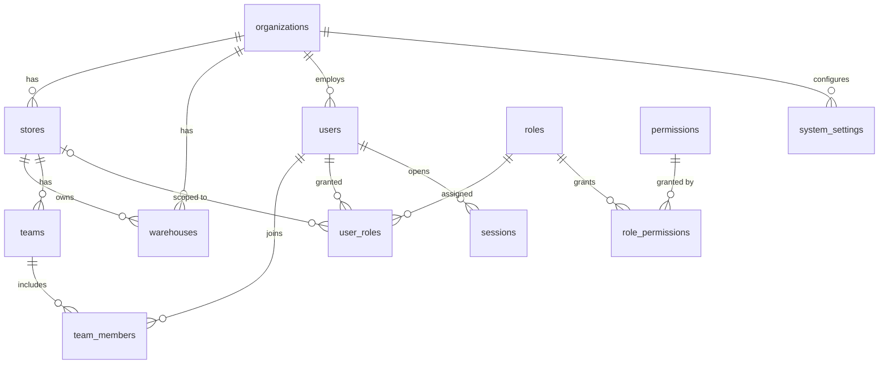
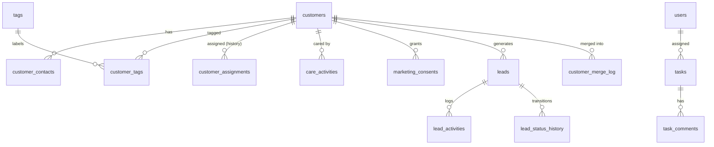
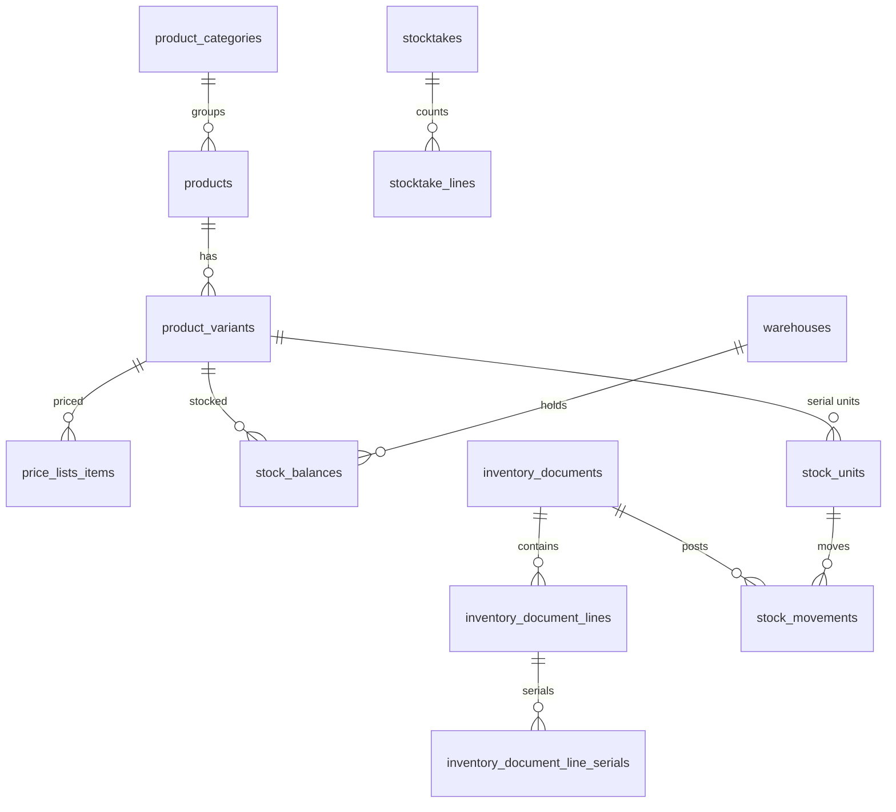
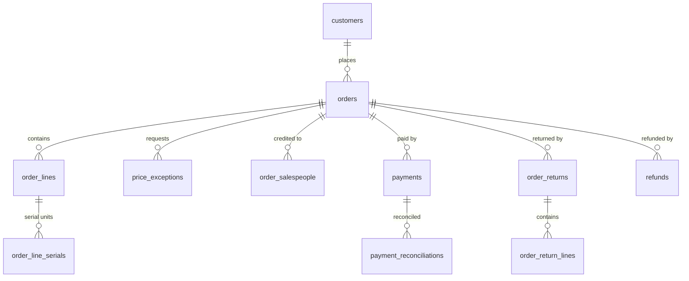

# Thiết kế cơ sở dữ liệu (ERD)

PostgreSQL 16. Trạng thái cột “Sprint”: **0** = đã tạo bằng migration và có kiểm thử; số khác = thiết
kế, sẽ tạo bằng migration riêng ở sprint đó (có thể tinh chỉnh khi triển khai, ghi lại trong báo cáo).

## 1. Quy ước

| Quy ước         | Chi tiết                                                                                             |
| --------------- | ---------------------------------------------------------------------------------------------------- |
| Đặt tên         | Bảng/cột `snake_case`, bảng số nhiều; model Prisma PascalCase                                        |
| Khóa chính      | `uuid` v7 (sinh theo thời gian); bảng log/sự kiện dùng `bigint identity`                             |
| Thời gian       | `timestamptz(3)`, lưu UTC; hiển thị `Asia/Ho_Chi_Minh`; “ngày nghiệp vụ” tính theo giờ Việt Nam      |
| Tiền            | `bigint` đồng VND, hậu tố `_amount` / `_price` / `_cost`; không bao giờ `numeric` float hay `double` |
| Tỷ lệ           | `integer` basis point, hậu tố `_bps` (VAT 10% = 1000)                                                |
| Số lượng        | `integer` (đơn vị nhỏ nhất của sản phẩm)                                                             |
| Optimistic lock | Cột `version int not null default 1` trên bảng có thể sửa đồng thời                                  |
| Xóa             | Không xóa cứng dữ liệu nghiệp vụ; dùng `status` / `archived_at`. Chứng từ đã ghi sổ bất biến         |
| Audit           | `created_by_id`, `updated_by_id` + bản ghi `audit_logs` cho thao tác quan trọng                      |
| Phạm vi         | Bảng nghiệp vụ có `store_id` (và `warehouse_id` cho kho) để hỗ trợ nhiều cửa hàng                    |
| Ràng buộc       | Ưu tiên ràng buộc DB (FK, UNIQUE, CHECK, trigger) làm hàng rào cuối, kể cả khi ứng dụng đã kiểm tra  |

## 2. Nền tảng: tổ chức, nhân sự, phân quyền, phiên, nhật ký (Sprint 0 — đã tạo)

| Bảng               | Cột chính                                                                                                                      | Ràng buộc nổi bật                                                                                   |
| ------------------ | ------------------------------------------------------------------------------------------------------------------------------ | --------------------------------------------------------------------------------------------------- |
| `organizations`    | code, name, timezone, currency                                                                                                 | code `^[A-Z0-9_-]{2,32}$`                                                                           |
| `stores`           | organization_id, code, name, address, phone, is_active                                                                         | unique (org, code), CHECK format                                                                    |
| `warehouses`       | organization_id, store_id, code, name, is_main                                                                                 | unique (org, code); **tối đa 1 kho chính/tổ chức** (index partial)                                  |
| `teams`            | store_id, name                                                                                                                 | unique (store, name)                                                                                |
| `team_members`     | team_id, user_id, role (MEMBER/LEAD)                                                                                           | PK (team, user); **tối đa 1 trưởng nhóm/nhóm**                                                      |
| `users`            | email, full_name, employee_code, password_hash, status, failed_login_count, locked_until, mfa_enabled, mfa_secret_enc, version | email unique không phân biệt hoa thường; ACTIVE/LOCKED bắt buộc có hash; MFA bật bắt buộc có secret |
| `roles`            | code, name, is_system                                                                                                          | code unique; trigger chặn đổi mã vai trò đang nắm quyền 🔒                                          |
| `permissions`      | key, module, label, scoped, director_only, sensitive                                                                           | trigger chặn bật director_only khi đang gán cho vai trò khác                                        |
| `role_permissions` | role_id, permission_key, scope                                                                                                 | **trigger: quyền director_only chỉ gán cho DIRECTOR**; quyền không phân phạm vi chỉ nhận `ORG`      |
| `user_roles`       | user_id, role_id, store_id (NULL = mọi cửa hàng), granted_by_id                                                                | unique (user, role, store) coi NULL là một giá trị                                                  |
| `sessions`         | token_hash (SHA-256 hex), expires_at, last_seen_at, mfa_verified_at, ip, user_agent, revoked_at                                | token_hash unique, đúng 64 hex; expires_at > created_at                                             |
| `access_logs`      | user_id, identifier, event, ip, user_agent, metadata                                                                           | **append-only** (trigger chặn UPDATE/DELETE/TRUNCATE)                                               |
| `audit_logs`       | actor_user_id, action, entity_type, entity_id, before, after, reason, request_id, ip                                           | **append-only**                                                                                     |
| `idempotency_keys` | (scope, key), request_hash, response_status, response_body, expires_at                                                         | PK (scope, key)                                                                                     |
| `system_settings`  | (organization_id, key), value jsonb, version                                                                                   | cấu hình nghiệp vụ có phiên bản                                                                     |
| `outbox_events`    | type, payload, attempts, available_at, processed_at                                                                            | transactional outbox cho BullMQ                                                                     |

## 3. Khách hàng, Lead, Công việc (Sprint 2)

| Bảng                    | Cột chính                                                                                                                                   | Ràng buộc / ghi chú                                                                   |
| ----------------------- | ------------------------------------------------------------------------------------------------------------------------------------------- | ------------------------------------------------------------------------------------- |
| `customers`             | store_id, code, full_name, phone_normalized, email, gender, birthday, address, segment, source, owner_user_id, status, version, archived_at | unique (store, phone_normalized) cho khách đang hoạt động; owner dùng cho phạm vi OWN |
| `customer_assignments`  | customer_id, from_user_id, to_user_id, reason, assigned_by_id, assigned_at                                                                  | lịch sử chuyển giao, append-only                                                      |
| `customer_tags`, `tags` |                                                                                                                                             | unique (customer, tag)                                                                |
| `care_activities`       | customer_id, user_id, channel, content, next_follow_up_at                                                                                   |                                                                                       |
| `marketing_consents`    | customer_id, channel, granted, source, evidence, recorded_by_id, recorded_at                                                                | append-only; trạng thái hiện hành = bản ghi mới nhất theo kênh (D-16)                 |
| `customer_merge_log`    | survivor_id, merged_id, snapshot, merged_by_id                                                                                              | gộp khách trùng có thể truy vết                                                       |
| `leads`                 | store_id, customer_id, source, status, owner_user_id, expected_value_amount, lost_reason, next_action_at, won_order_id, version             | `status` theo `leadMachine`; LOST bắt buộc `lost_reason` (CHECK)                      |
| `lead_status_history`   | lead_id, from_status, to_status, actor_id, at                                                                                               | dùng tính tỷ lệ chuyển đổi                                                            |
| `tasks`                 | store_id, title, description, assignee_id, created_by_id, due_at, status, priority, related_type, related_id, version                       | quá hạn = `due_at < now() AND status NOT IN (DONE, CANCELLED)`                        |
| `work_schedules`        | user_id, date, shift_start, shift_end                                                                                                       | unique (user, date, shift_start)                                                      |
| `kpi_targets`           | user_id / team_id, period, metric, target_value                                                                                             | CHECK đúng một trong user_id/team_id                                                  |

## 4. Sản phẩm, giá, kho (Sprint 3)

| Bảng                            | Cột chính                                                                                                                                                                                                                         | Ràng buộc / ghi chú                                                                                                                                        |
| ------------------------------- | --------------------------------------------------------------------------------------------------------------------------------------------------------------------------------------------------------------------------------- | ---------------------------------------------------------------------------------------------------------------------------------------------------------- |
| `products`                      | sku_base, name, category_id, serial_tracking (bool), tax_rate_bps, business_status, version                                                                                                                                       |                                                                                                                                                            |
| `product_variants`              | product_id, sku, attributes jsonb, condition (NEW/USED/REFURBISHED), version                                                                                                                                                      | sku unique                                                                                                                                                 |
| `variant_prices`                | variant_id, store_id, list_price, floor_price, effective_from, effective_to, created_by_id                                                                                                                                        | **có phiên bản theo thời gian**, không sửa đè; CHECK `floor_price >= 0`, `list_price >= floor_price`; exclusion constraint chống chồng lấn khoảng hiệu lực |
| `stock_balances`                | warehouse_id, variant_id, qty_on_hand, qty_reserved, version                                                                                                                                                                      | PK (warehouse, variant); CHECK `qty_on_hand >= 0`, `qty_reserved >= 0`, `qty_on_hand - qty_reserved >= 0` (**không âm khả dụng**)                          |
| `stock_units`                   | variant_id, serial, warehouse_id, status, condition, unit_cost, reserved_order_id, version                                                                                                                                        | unique (variant, serial); `status` theo `stockUnitMachine`; CHECK `reserved_order_id` NOT NULL ⇔ RESERVED                                                  |
| `inventory_documents`           | store_id, warehouse_id, type (RECEIPT, ISSUE, RETURN_IN, STATUS_CHANGE, ADJUSTMENT, STOCKTAKE, OPENING, REVERSAL), status, source_type, source_id, reverses_document_id, reason, approved_by_id, posted_by_id, posted_at, version | `status` theo `inventoryDocumentMachine`; trigger chặn UPDATE dòng/chứng từ POSTED; ADJUSTMENT/REVERSAL bắt buộc người duyệt có quyền 🔒                   |
| `inventory_document_lines`      | document_id, variant_id, quantity, unit_cost                                                                                                                                                                                      | CHECK quantity > 0                                                                                                                                         |
| `stock_movements`               | document_id, line_id, warehouse_id, variant_id, stock_unit_id, qty_delta, cost_delta, at                                                                                                                                          | append-only; nguồn gốc bắt buộc; tổng `qty_delta` = `stock_balances.qty_on_hand` (kiểm thử đối soát)                                                       |
| `stocktakes`, `stocktake_lines` | counted_qty, system_qty                                                                                                                                                                                                           | chênh lệch tạo chứng từ ADJUSTMENT chờ Giám đốc duyệt                                                                                                      |

## 5. Đơn hàng, thanh toán, hoàn tiền (Sprint 4)

| Bảng                | Cột chính                                                                                                                                                                                              | Ràng buộc / ghi chú                                                                                                |
| ------------------- | ------------------------------------------------------------------------------------------------------------------------------------------------------------------------------------------------------ | ------------------------------------------------------------------------------------------------------------------ |
| `orders`            | store_id, code, customer_id, owner_user_id, status, payment_status, subtotal_amount, discount_amount, tax_amount, total_amount, paid_amount, refunded_amount, confirmed_at, version                    | `status` theo `orderMachine`; CHECK `0 <= refunded_amount <= paid_amount`; tổng tiền tính lại ở server             |
| `order_lines`       | order_id, variant_id, quantity, **snapshot**: unit_price, list_price, floor_price, unit_cost, tax_rate_bps, discount_amount, line_net_amount (chưa VAT), line_tax_amount, commission_policy_version_id | snapshot ghi khi CONFIRM, bất biến sau đó                                                                          |
| `price_exceptions`  | order_id, order_version, conditions_hash, requested_by_id, reason, status, decided_by_id, decided_at, decision_note, expires_at                                                                        | `status` theo `priceExceptionMachine`; CHECK `decided_by_id <> requested_by_id`; unique 1 PENDING/APPROVED mỗi đơn |
| `order_salespeople` | order_id, user_id, share_bps                                                                                                                                                                           | tổng share = 10000 (trigger kiểm tra khi CONFIRM)                                                                  |
| `payments`          | order_id, method (CASH, BANK_TRANSFER), amount, status, reference, received_by_id, idempotency_key, reconciled_at                                                                                      | CHECK amount > 0; unique idempotency_key; tổng SUCCEEDED ≤ total (kiểm tra có khóa dòng đơn)                       |
| `refunds`           | order_id, return_id, amount, method, status, requested_by_id, approved_by_id, executed_by_id, failure_reason, idempotency_key                                                                          | `status` theo `refundMachine`; CHECK amount > 0; tổng SUCCEEDED ≤ paid − đã hoàn                                   |
| `order_returns`     | order_id, type (RETURN, EXCHANGE), status, reason, approved_by_id, replacement_order_id                                                                                                                |                                                                                                                    |
| `receivables`       | view/materialized từ orders − payments + refunds                                                                                                                                                       | công nợ, cảnh báo quá hạn                                                                                          |

## 6. Hoa hồng, KPI, báo cáo (Sprint 5)

| Bảng                  | Cột chính                                                                                                                                                                                                                 | Ràng buộc / ghi chú                                                                                  |
| --------------------- | ------------------------------------------------------------------------------------------------------------------------------------------------------------------------------------------------------------------------- | ---------------------------------------------------------------------------------------------------- |
| `commission_policies` | name, version, effective_from, rules jsonb (tỷ lệ theo nhân viên / nhóm sản phẩm, bps), created_by_id                                                                                                                     | **phiên bản bất biến**; đơn snapshot `commission_policy_version_id`                                  |
| `commission_periods`  | period (YYYY-MM, giờ VN), status, closed_by_id, closed_at, totals jsonb                                                                                                                                                   | unique period; `status` theo `commissionPeriodMachine`                                               |
| `commission_entries`  | period_id, order_id, order_line_id, user_id, share_bps, net_revenue_amount, cost_amount, gross_profit_amount, rate_bps, commission_amount, kind (ACCRUAL, RETURN_ADJUSTMENT, MANUAL_ADJUSTMENT), status, adjusts_entry_id | `status` theo `commissionMachine`; trigger chặn sửa dòng thuộc kỳ CLOSED; điều chỉnh = dòng mới (âm) |
| `commission_payouts`  | period_id, user_id, amount, paid_by_id, paid_at, reference                                                                                                                                                                |                                                                                                      |
| Báo cáo               | view SQL có `source_type/source_id` để mọi chỉ số truy ngược được giao dịch nguồn                                                                                                                                         | dashboard không tự tính tiền ở frontend                                                              |

## 7. Thông báo (Sprint 1–5)

| Bảng            | Ghi chú                                                                                    |
| --------------- | ------------------------------------------------------------------------------------------ |
| `notifications` | user_id, type, title, body, link, read_at, created_at — sinh từ `outbox_events` bởi worker |
| `alert_rules`   | cấu hình ngưỡng cảnh báo (tồn thấp, công nợ, hành vi bất thường)                           |

## 8. Migration hiện có

| Migration                                  | Nội dung                                                                                                      |
| ------------------------------------------ | ------------------------------------------------------------------------------------------------------------- |
| `20261019171820_foundation`                | Toàn bộ bảng mục 2, enum, FK, CHECK, index partial/biểu thức, trigger append-only, trigger quyền chỉ-giám-đốc |
| `20261019173000_user_roles_partial_unique` | Thay index `NULLS NOT DISTINCT` bằng 2 index partial tương đương (tránh drift Prisma)                         |

Quy trình: `pnpm db:migrate:dev` (dev, tạo migration mới) → review SQL → commit; production chỉ chạy
`prisma migrate deploy`. Không sửa migration đã áp dụng; sửa bằng migration mới.
